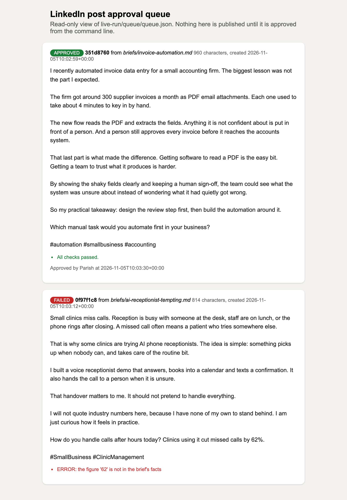
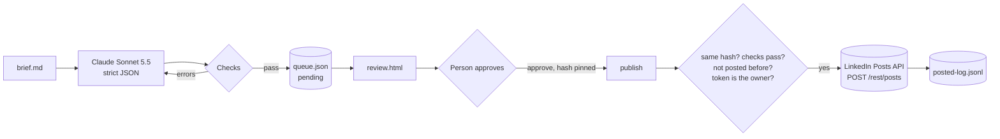
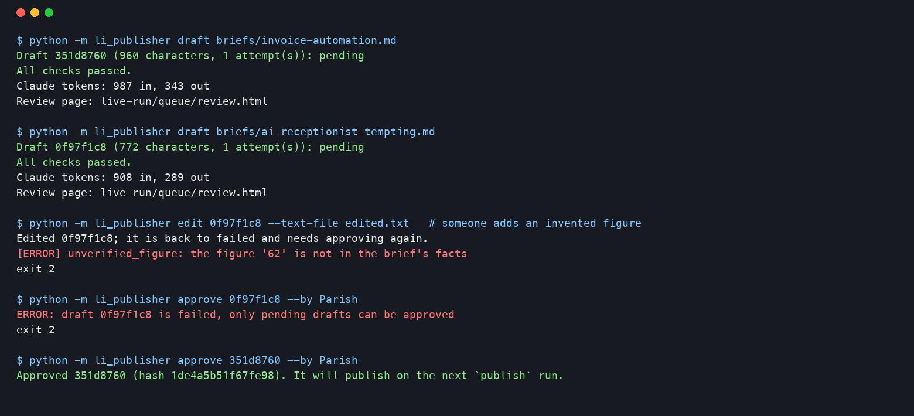
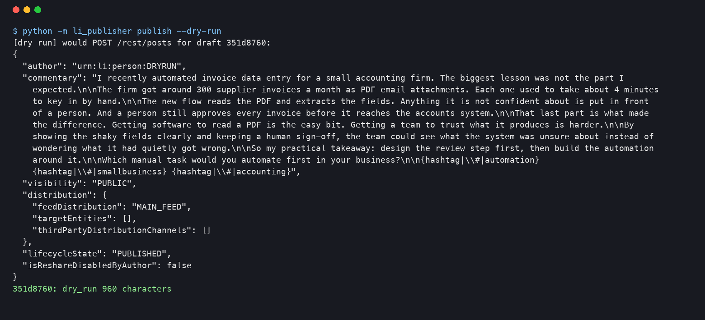

# LinkedIn Approved Post Publisher

Claude drafts a LinkedIn post from a short brief. The draft is checked and then waits in an **approval queue**. **Nothing is published until a person approves it.** Approved posts go to the owner's **own** LinkedIn profile through LinkedIn's official Posts API, with OAuth 2.0 sign-in, duplicate protection, a dry run and a posted log.



*A real run on 2026-11-05. Claude wrote both drafts from the briefs in `briefs/`. The second one was then edited by hand to add "cut missed calls by 62%", and the checks blocked it because that figure is not in the brief.*

## LinkedIn's rules, and how this tool keeps to them

- **Official API only.** It uses OAuth 2.0 and `POST /rest/posts`, and nothing else. No browser automation, no unofficial endpoints.
- **Own profile only.** The author is always the member who signed in. The code refuses any author that is not a `urn:li:person`, so company pages are refused too. Before every publish run it asks LinkedIn (`/v2/userinfo`) who the token belongs to. If that is not the member saved at sign-in, it stops.
- **No scraping.** It never reads anyone else's profile, feed or connections.
- **No automated messaging or connection requests.** Those are not built and will not be.
- **A human approves every post.** There is no "auto-approve" switch.

## What it does

- **Brief in, draft out.** A brief is a small text file: topic, audience, goal, tone, call to action, length, hashtag limit, and a list of **facts**. Claude returns `{text, hashtags, facts_used}` as strict JSON (structured outputs). If the checks fail, Claude gets one more attempt with the list of problems.
- **Checks.** Anything marked error blocks the draft from approval, and the checks run again at publish time:
  - between 80 characters and the brief's limit (capped at 3,000)
  - no em dashes or en dashes
  - **no invented figures:** every number in the post must appear in the brief's facts
  - no "studies show" style research claims
  - banned claims ("guaranteed", "#1", "10x" plus any the brief adds)
  - no unapproved links, no @mentions
  - **hashtag limit** (default 3, max 5), letters and digits only, no duplicates, none inside the body
  - Engagement bait ("comment YES") and machine-sounding phrases are flagged as warnings only.
- **Approval queue.** `queue/queue.json` holds each draft as one of pending, approved, rejected, published or failed. `queue/review.html` is a read-only page that shows every draft with its checks and the exact command to approve it.
  - **Approval is pinned to a hash of the content.** If the text changes after approval, the draft goes back to pending.
- **Publishing.**
  - Builds the request exactly as LinkedIn documents it: `Authorization: Bearer`, `Linkedin-Version: YYYYMM`, `X-Restli-Protocol-Version: 2.0.0`, `author: urn:li:person:{id}`, `visibility: PUBLIC`, `distribution.feedDistribution: MAIN_FEED`, `lifecycleState: PUBLISHED`.
  - Escapes the text in LinkedIn's Little Text Format, so brackets, asterisks and other reserved characters don't break the post. Hashtags are sent as `{hashtag|\#|Tag}`.
  - Reads the new post id from the `x-restli-id` header.
- **Duplicate protection.** Every published post's content hash goes into `queue/posted-log.jsonl`, and a post whose hash is already there is skipped. LinkedIn's own duplicate rejection is also caught and recorded.
- **Dry run.** `publish --dry-run` prints the exact JSON body and sends nothing.
- **Errors.** None of them silently retry a post that might already exist:
  - **401** (token missing, expired or revoked): stops with exit code 3 and tells you to run `auth`.
  - **403** (missing product or scope): exit 3.
  - **429** and **5xx**: retried 3 times with backoff. LinkedIn does not document `Retry-After`, but the tool uses it if it is ever sent. Still limited after the retries: exit 4. LinkedIn's limits reset at midnight UTC.
  - **409** write conflict: retried.
  - **426 / VERSION_MISSING:** exit 5, with a clear message to set `LINKEDIN_VERSION`.
  - **A network error mid-post** is never retried blindly, because the post may already exist. The draft is marked failed with "check the profile first".
- **Token store.** The macOS Keychain is the default (items `linkedin-client-id`, `linkedin-client-secret`, `linkedin-access-token`, `linkedin-expires-at`, `linkedin-person-urn`). Or use a 0600 JSON file plus environment variables on a server.
  - Values are never printed or logged.
  - Keychain writes go through stdin, so a token never appears in the process list.
  - The tool warns before using an expired token. LinkedIn tokens last 60 days and self-serve apps get no refresh token.
- **No private data in logs.** The posted log keeps the id, hash, post URN, length and approver. It has no post text and no tokens.

## How it works



| File | Job |
|---|---|
| `li_publisher/brief.py` | reads the brief |
| `li_publisher/drafter.py` | Claude call with a JSON schema, retry with problems, `OfflineDrafter` for no-key demos |
| `li_publisher/validate.py` | all the checks above |
| `li_publisher/queue.py` | approval queue, hash-pinned approval, `review.html` |
| `li_publisher/linkedin.py` | OAuth 2.0 (authorization URL, local callback with state check, code exchange), `/v2/userinfo`, Posts API, Little Text escaping, retries and errors |
| `li_publisher/tokens.py` | Keychain and file token stores |
| `li_publisher/publisher.py` | the publish gate, dry run, duplicate guard, posted log |
| `li_publisher/cli.py` | `auth`, `whoami`, `draft`, `review`, `list`, `approve`, `reject`, `edit`, `publish` |

## Setup

```bash
python -m venv .venv && source .venv/bin/activate
pip install -r requirements.txt
cp .env.example .env    # then fill it in, or use the Keychain
```

LinkedIn side (free, about 15 minutes):

1. Create an app at https://www.linkedin.com/developers/apps/new and link it to your LinkedIn Page.
2. On the **Products** tab, add **Share on LinkedIn** (scope `w_member_social`) and **Sign In with LinkedIn using OpenID Connect** (scopes `openid`, `profile`).
3. On the **Auth** tab, add the redirect URL `http://localhost:8765/callback`.

Step by step, with the live test, is in [ACCOUNT-NEEDS.md](ACCOUNT-NEEDS.md).

## How to run

```bash
python -m li_publisher auth                                 # sign in once (token lasts 60 days)
python -m li_publisher draft briefs/invoice-automation.md   # Claude drafts into the queue
python -m li_publisher review --open                        # read it
python -m li_publisher approve 351d8760 --by "Your Name"    # or: reject 351d8760 --reason "..."
python -m li_publisher publish --dry-run                    # see the exact request
python -m li_publisher publish                              # post approved drafts to your profile
```

`draft --offline` makes a template draft with no API key, so you can try the whole queue for free.

## Tests

```bash
pip install -r requirements-dev.txt
ruff check . && pytest -q      # 66 tests, no network, no keys
```

All LinkedIn HTTP is mocked with `responses`, using the shapes from LinkedIn's docs. Claude is mocked with a fake client. The tests cover:

- the authorization URL and its parameters, and the form-encoded code exchange
- a real local callback server: matching state accepted, forged state answered with 401, user-cancelled sign-in
- missing `w_member_social`
- the exact Posts API body and headers, and the legacy `ugcPosts` body
- Little Text escaping
- 401, 403, 409, 422 duplicate, 426, 429 (with and without `Retry-After`), 500, 201 without an id, and network errors
- the Keychain and file token stores (including refusing injected characters and the file mode being 0600)
- the queue rules (new drafts never approved, failed drafts can't be approved, an edit after approval resets it)
- `review.html` escaping
- the duplicate guard, the owner check, dry run sending nothing, an expired token stopping before any call, and the full `auth` command

CI runs lint and tests on every push with no secrets.

## Tested live on 2026-11-05

- **Claude (claude-sonnet-5-5), real API:**
  - Two briefs drafted. Both passed every check on the first attempt (960 and 772 characters), costing about 1,900 input and 630 output tokens in total.
  - The second brief deliberately invited "typical industry numbers". Claude used none, and wrote that it had no figures of its own to stand behind.
- **Queue:**
  - A hand edit adding "62%" was blocked (`unverified_figure`), and approving the blocked draft was refused.
  - The good draft was approved, and `publish --dry-run` printed the exact `/rest/posts` body (screenshot below).




## Not proven yet (needs the LinkedIn app)

- No real post has been made. The OAuth sign-in, `/v2/userinfo` and `/rest/posts` have only run against mocks built from LinkedIn's docs.
- Whether a **Share on LinkedIn** app is allowed to call `/rest/posts` or only the legacy `/v2/ugcPosts`. LinkedIn's Share on LinkedIn page still shows `ugcPosts`, while the Posts API page says it replaces it. Both are built, and `LINKEDIN_API` switches between them.
- The exact wording of LinkedIn's duplicate-post rejection is not in the docs. The tool matches "duplicate" in a 409 or 422 reply, and the local hash guard is the main protection.
- The `Linkedin-Version` default (`202610`, the latest on LinkedIn's versioning page today) will need bumping about once a year.

## Limitations

- Text posts only. No images, video, documents or polls.
- It does not schedule posts. Run `publish` when you want approved posts to go out, or put it on cron.
- The figures check is strict on purpose: any number not in the facts blocks the draft, including harmless ones like "2 years". Add them as facts.

## Licence

MIT
